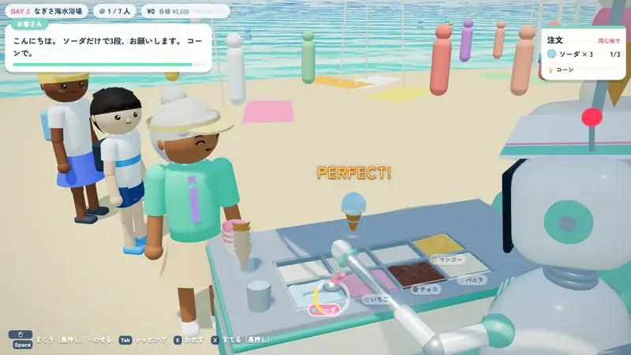
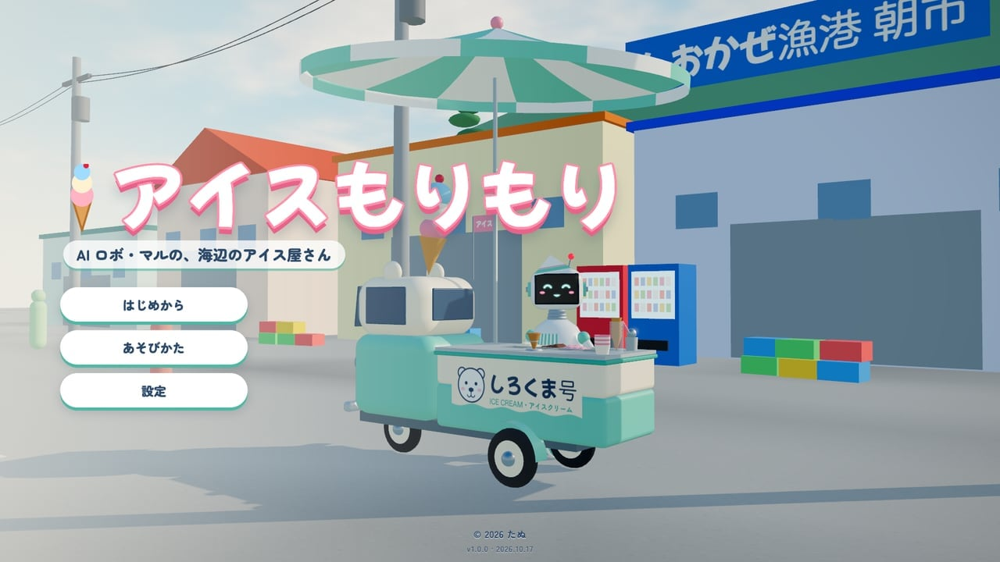
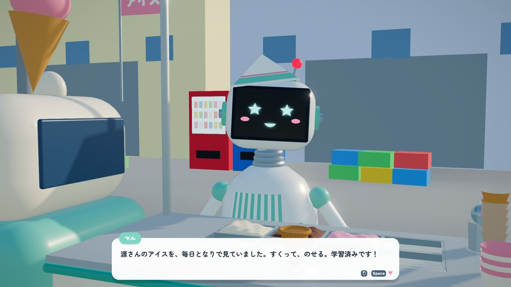
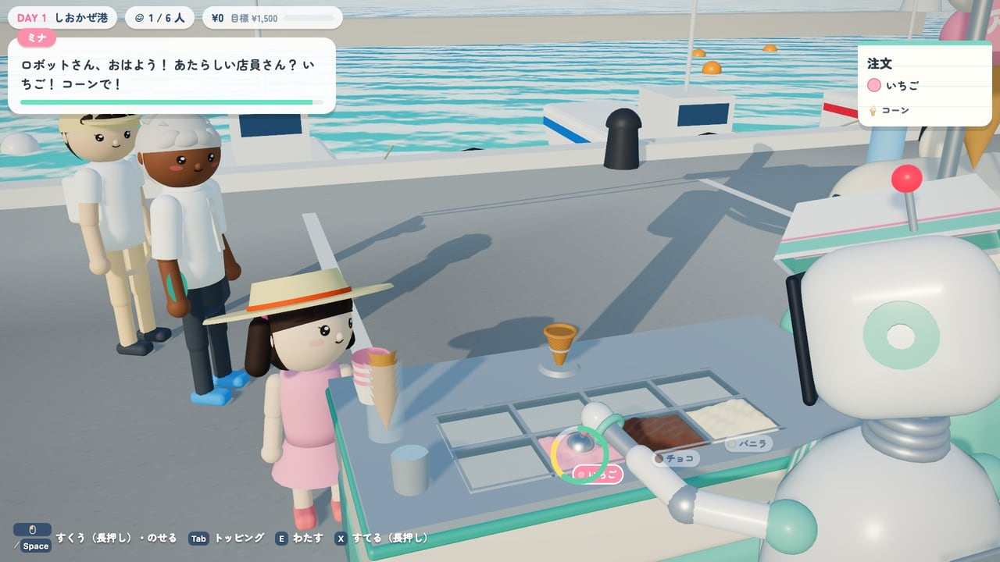
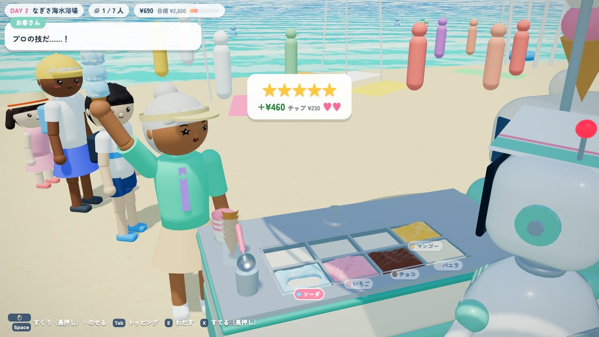
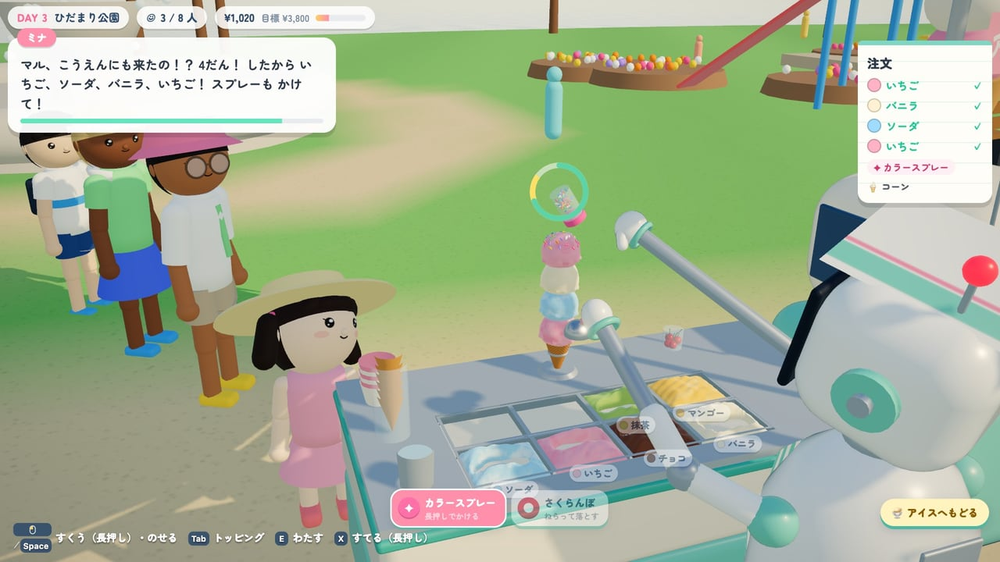
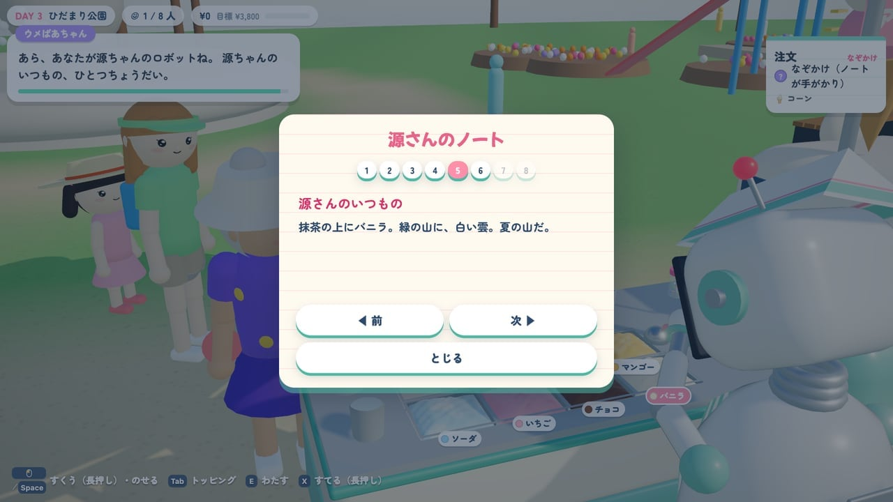
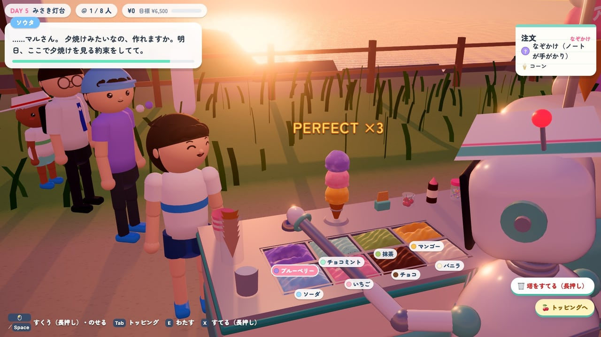
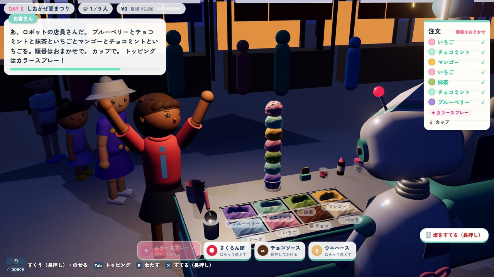

# アイスもりもり — Ice Mori-Mori

AI ロボのマルが、海辺の町で移動アイス屋さん。すくって、ねらって、のせて、もりもり積む、ブラウザで遊べる 3D ゲーム。

[](https://tanuu5.github.io/ice-morimori/)
[](https://www.anthropic.com/claude)
[](./LICENSE)
[](#english)

<p align="center">
  
</p>

<p align="center"><b><a href="https://tanuu5.github.io/ice-morimori/">▶ ブラウザで今すぐ遊ぶ</a></b>（インストール不要）</p>

**Claude Code × Claude Opus 5.5（MAX）** で作りました。

夏休みの「しおかぜ町」。腰を痛めた店主の源さんに代わって、皿洗い用のロボ・マルが、四十年つづく移動アイス屋「しろくま号」を走らせます。注文どおりにケースのアイスをすくい、塔の上で揺れる玉をタイミングよく落として、コーンの上に積み上げていきます。港・海水浴場・公園・駅前・岬・夏まつりと 6 日間で町をめぐり、常連さんたちの小さな物語に出会います。屋台や人の模型、看板、曲と効果音は、画像や音声のファイルを使わず、すべてコードで作っています。

日本語と英語に対応しています（ブラウザの言語に合わせて切り替わり、タイトルの「設定」でも変えられます）。English follows below.

## スクリーンショット

<table>
  <tr>
    <td width="50%"><br><sub>タイトル画面。朝の港に、マルと移動アイス屋「しろくま号」。</sub></td>
    <td width="50%"><br><sub>物語は、源さんからの電話で始まる。「すくって、のせる。学習済みです！」</sub></td>
  </tr>
  <tr>
    <td width="50%"><br><sub>味を選んで長押しすると、玉が育つ。黄色の帯で離せば、ちょうどいい大きさ。</sub></td>
    <td width="50%"><br><sub>注文どおりに積んで手わたすと、星とお代とチップ。</sub></td>
  </tr>
  <tr>
    <td width="50%"><br><sub>3 日目からトッピング。スプレーは長押しでふりかけ、さくらんぼはねらって落とす。</sub></td>
    <td width="50%"><br><sub>ときどき謎かけの注文。「源ちゃんのいつもの」の手がかりは、源さんのノートに。</sub></td>
  </tr>
  <tr>
    <td width="50%"><br><sub>岬の灯台は夕焼けの中。「夕焼けみたいなの、作れますか」に、色で答える。</sub></td>
    <td width="50%"><br><sub>最終日は夜の夏まつり。7 段のカップにスプレーまでのせて、大よろこび。</sub></td>
  </tr>
</table>

画像と動画は、すべて実際の画面です。

## 遊び方

1. お客さんの注文を、右上の伝票で確かめる（味・段数・器・トッピング）。段は下から順に。
2. ケースの味を選んで長押し。玉が育つ。黄色の帯で離すと、ちょうどいい大きさ。
3. 玉が塔の上で左右に揺れる。真ん中に来たら押して落とす。ずれると塔が傾き、外すと落ちる。段が増えるほど揺れは大きく速くなり、アイスは少しずつ溶ける。
4. トッピング（3 日目から）は切りかえて。スプレー・ソースは長押しでかけ、さくらんぼ・ウエハースはねらって落とす。
5. できたら「わたす」。作り直すときは「すてる」を長押し（揺れている玉だけ、または塔ごと）。
6. 売上で屋台を改造できる（冷却ファン・ジャイロ・呼びこみの鈴・ねらいライト）。6 日目のあとは、エンドレス営業も。

| 操作 | キーボード・マウス | ゲームパッド | スマホ（タッチ） |
| --- | --- | --- | --- |
| 味を選ぶ | `←` `→` `↑` `↓`／名札をクリック | 十字キー・左スティック | 名札をタップ |
| すくう（長押し）・落とす | `Space`・`J`／左クリック・名札を長押し | A | 「すくう」・名札を長押し |
| わたす | `E`・`Enter` | Y | 「わたす」 |
| トッピングへ切りかえ | `Tab`・`Q` | X・LB・RB | 「トッピング」 |
| すてる（長押し） | `X`・`Delete` | B | 「すてる」を長押し |
| 源さんのノート | `N` | View（Back） | 一時停止のメニューから |
| 一時停止 | `Esc`・`P` | Menu（Start） | 右上の「Ⅱ」 |

進み具合は、1 日の営業が終わるごとにブラウザに保存されます（タイトルの「つづきから」で続きから遊べます）。

## 制作について

企画・ディレクション：**たぬ**　／　開発：**Claude Code（Claude Opus 5.5・推論レベル MAX）**

テーマと方向性をたぬが決め、設計から実装・テストまでを Claude Code が進めました。塔の揺れは、玉どうしのつなぎ目をばねに見立てて毎フレーム釣り合いを解く小さな物理で、真ん中に積めば自然に立ち直り、ずれると傾いて、限界を超えると折れて落ちます。人や屋台・町並みは three.js の基本の形の組み合わせ、看板や顔はキャンバスで描き、曲と効果音は Web Audio で合成しています。確かめは、実 GPU のヘッドレス Chrome での撮影と、6 日間を通して遊ぶ自動プレイで行い、たぬが実際に遊んだ感想（ヒントの吹き出しの位置、「すてる」の案内など）を直してから公開しました。

## 更新履歴

- **2026-10-17**：公開（v1.0.0）

## 開発

```bash
npm install
npm run dev      # 開発サーバー（http://127.0.0.1:5194/）
npm run build    # dist/ に公開用のファイル（相対パスなので、どこに置いても動く）
```

- `?dev` を付けると、開発用の `window.__dev` が使えます（`__dev.goto('play', { day: 3 })` で 3 日目の営業から、`__dev.game.auto.stack(5)` で 5 段積む、など）。
- `?lang=en` で英語、`?quality=high` で画質を固定、`?mute=1` で音なし。

| 場所 | 中身 |
| --- | --- |
| `src/game/` | ゲームの流れ（`Game.js`）、調理台（`Counter.js`）、塔（`Tower.js`・`sim/towerPhysics.js`）、営業（`Shift.js`） |
| `src/game/scene/` | 3D の模型（屋台・ロボ・お客さん・アイス・6 つの場所） |
| `src/game/data/` | 日・味・トッピング・常連・物語・改造のデータ |
| `src/audio/` | 合成の楽器・効果音・曲・環境音 |
| `src/i18n/` | 日本語・英語の文言（物語は `story.*.js`） |
| `src/core/`・`src/ui/` | 入力・保存・設定・画面などの土台 |
| `dev/` | 開発用の確認台（模型の確認、音の確認） |

## GitHub Pages で公開する

`main` に push すると、GitHub Actions（`.github/workflows/deploy.yml`）がビルドして公開します。初回だけ、リポジトリの Settings → Pages → Source を「GitHub Actions」にします。

## クレジット・ライセンス

- コード：MIT License（[LICENSE](LICENSE)）© 2026 たぬ
- 3D 描画：[three.js](https://threejs.org/)（MIT License）
- ビルド：[Vite](https://vite.dev/)（MIT License）
- フォント：[Mochiy Pop One](https://fonts.google.com/specimen/Mochiy+Pop+One)、[Zen Maru Gothic](https://fonts.google.com/specimen/Zen+Maru+Gothic)（Google Fonts からページで読み込み。SIL Open Font License）
- 画像・音声のファイルは使っていません（模型・看板・曲・効果音は、すべてコードで生成）。
- 町・人物・お店はすべて架空です。
- MIT License の対象はこのリポジトリのコードと文章です。「Claude」の名前や商標の使用を許諾するものではありません。

---

## English

**▶ Play in your browser: https://tanuu5.github.io/ice-morimori/**

Ice Mori-Mori is a 3D ice-cream-stacking game for the browser, made with **Claude Code × Claude Opus 5.5 (MAX)**. When old Gen throws out his back, Maru — the robot he fixed up to wash dishes — takes his forty-year-old ice cream cart around a seaside town for the summer. The game follows your browser's language; you can switch between English and Japanese in Settings, or add `?lang=en` to the URL.

- Hold to scoop, and release in the yellow band for a perfect-sized scoop.
- The scoop swings over the tower: drop it when it is centered. Off-center scoops tilt the tower, misses fall off, and tall towers wobble and slowly melt.
- Toppings: hold to sprinkle or pour sauce; aim and drop cherries and wafers.
- Six days in six places — harbor, beach, park, station street, cape lighthouse and a night festival — with regulars' little stories, riddle orders and Gen's notebook, plus an endless mode after the ending.
- Everything is generated in code: models, signs, music and sound effects. There are no image or audio files.

Controls: hold `Space` or the left mouse button to scoop, press to drop · `←` `→` choose a flavor · `E` serve · `Tab` toppings · hold `X` to toss · `N` notebook · `Esc` pause. Gamepad and touch controls are supported too.

Code is released under the MIT License. Built with three.js (MIT).
